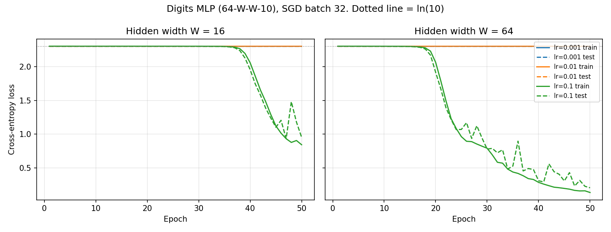

# Lab 2: A Neural Network from Scratch

## 1. Goal

Build a two-hidden-layer neural network in plain NumPy (no autograd). Implement the forward pass,
cross-entropy loss and backpropagation, verify the gradients numerically, train it on the Digits dataset
with different learning rates and widths, and time the forward and backward passes.

## 2. Method

- **Environment:** pinned venv from the repo `requirements.txt`; versions in `results/versions.txt` (Python 3.11.8 (CPython)).
  Seeds 42 for `random`, NumPy and PyTorch, re-set before each run.
- **Data:** `load_digits`, 1797 images of 8×8 = 64 pixels. Inputs divided by 16 (range 0–1), labels one-hot
  (10 classes), 70/30 stratified split with `random_state=42` (1257 train / 540 test).
- **Network design (step 2):** 64 → W → ReLU → W → ReLU → 10 → softmax, for W = 16 and W = 64.
  Weights drawn from N(0, 0.01), interpreted as standard deviation 0.01; biases start at 0.

| Layer | W shape | b shape | Params W=16 | Params W=64 |
|---|---|---|---|---|
| Hidden 1 (+ReLU) | (64, W) | (W,) | 1040 | 4160 |
| Hidden 2 (+ReLU) | (W, W) | (W,) | 272 | 4160 |
| Output (+softmax) | (W, 10) | (10,) | 170 | 650 |
| **Total** |  |  | 1482 | 8970 |

- **Forward pass:** z1 = X·W1 + b1, a1 = ReLU(z1), z2 = a1·W2 + b2, a2 = ReLU(z2), z3 = a2·W3 + b3,
  p = softmax(z3), with the row max subtracted before exponentiating for stability.
- **Loss:** mean cross-entropy, L = −(1/B) Σ y·log p.
- **Backward pass (chain rule):** softmax and cross-entropy combine to dL/dz3 = (p − y)/B. Then
  dW3 = a2ᵀ·dz3 and db3 = Σ dz3; da2 = dz3·W3ᵀ and dz2 = da2 ⊙ 1[z2 > 0]; dW2 = a1ᵀ·dz2 and db2 = Σ dz2;
  dz1 = (dz2·W2ᵀ) ⊙ 1[z1 > 0]; dW1 = Xᵀ·dz1 and db1 = Σ dz1.
- **Gradient check:** on a batch of 32 training images, 10 random weights spread across W1, W2 and W3 are
  each nudged by ±1e−5. The numerical slope is (L(w+h) − L(w−h)) / 2h, and relative error is
  |a − n| / (|a| + |n|). It passes if the error is below 1e−6 for at least 9 of 10 weights. Weights are drawn from
  those with |gradient| ≥ 1e−5: behind a dead ReLU the gradient is exactly 0, and for near-zero gradients
  the relative error measures float64 round-off rather than correctness. The check is run on the untrained
  network and again after one epoch of training (lr = 0.1).
- **Training:** mini-batch SGD, batch 32, 50 epochs, data reshuffled each epoch. Train/test loss and
  accuracy logged every epoch (`results/train_log.csv`). Grid: learning rates [0.001, 0.01, 0.1] × widths [16, 64].
- **Timing:** forward and backward timed separately with `time.perf_counter`, 1 warm-up and then the median of
  100 runs, at batch 32 and at the full training set (1257 rows). I also counted the multiply-accumulates
  (MACs) in each pass's matrix multiplications.

## 3. Results

### Forward pass and loss sanity checks

| Check | W = 16 | W = 64 | Expected |
|---|---|---|---|
| Output shape (batch 32) | (32, 10) | (32, 10) | (32, 10) |
| Max \|row sum − 1\| | 2.2e-16 | 2.2e-16 | < 1e−6 |
| Untrained loss (train set) | 2.3026 | 2.3026 | ln(10) = 2.3026 |

### Gradient check (`results/gradient_check.csv`)

Passed: **10/10** on the untrained network and **10/10**
after one epoch (requirement: ≥ 9/10).

| Network state | Weight | Analytic | Numerical | Rel. error | < 1e-6 |
|---|---|---|---|---|---|
| untrained | W1[18,15] | -1.508512e-05 | -1.508511e-05 | 4.09e-07 | True |
| untrained | W2[9,12] | -8.577028e-05 | -8.577026e-05 | 1.11e-07 | True |
| untrained | W3[3,2] | 2.826753e-05 | 2.826752e-05 | 2.34e-07 | True |
| untrained | W1[30,7] | -1.209303e-05 | -1.209304e-05 | 2.22e-07 | True |
| untrained | W2[9,15] | -2.207963e-05 | -2.207965e-05 | 4.01e-07 | True |
| untrained | W3[14,4] | 3.837129e-05 | 3.837128e-05 | 2.95e-08 | True |
| untrained | W1[38,2] | 1.288592e-05 | 1.288594e-05 | 6.05e-07 | True |
| untrained | W2[1,0] | -9.114899e-05 | -9.114898e-05 | 4.29e-08 | True |
| untrained | W3[13,4] | 3.100255e-05 | 3.100256e-05 | 2.07e-08 | True |
| untrained | W1[35,14] | -2.099999e-05 | -2.1e-05 | 2.14e-07 | True |
| after 1 epoch | W1[10,4] | -4.771051e-05 | -4.77105e-05 | 6.15e-08 | True |
| after 1 epoch | W2[14,2] | 5.351426e-05 | 5.351428e-05 | 1.91e-07 | True |
| after 1 epoch | W3[9,7] | -7.5187e-05 | -7.518701e-05 | 4.81e-08 | True |
| after 1 epoch | W1[26,1] | -5.149687e-05 | -5.149687e-05 | 4.59e-08 | True |
| after 1 epoch | W2[8,5] | -1.142712e-05 | -1.142713e-05 | 1.2e-07 | True |
| after 1 epoch | W3[11,9] | 4.741194e-05 | 4.741192e-05 | 2.29e-07 | True |
| after 1 epoch | W1[12,0] | -4.435405e-05 | -4.435408e-05 | 2.95e-07 | True |
| after 1 epoch | W2[7,12] | -0.0001305416 | -0.0001305417 | 6.3e-08 | True |
| after 1 epoch | W3[14,7] | 1.796149e-05 | 1.79615e-05 | 3.52e-07 | True |
| after 1 epoch | W1[19,4] | -3.931268e-05 | -3.931269e-05 | 2.52e-08 | True |

### Training (`results/loss_curves.png`, `results/final_accuracy.csv`)

| W | LR | Final train loss | Final test loss | Train acc | Test acc | epoch loss < 2.0 |
|---|---|---|---|---|---|---|
| 16 | 0.001 | 2.302562 | 2.302549 | 0.1018 | 0.1019 | never |
| 16 | 0.01 | 2.302602 | 2.302473 | 0.1018 | 0.1019 | never |
| 16 | 0.1 | 0.844364 | 0.953795 | 0.6706 | 0.6722 | 41 |
| 64 | 0.001 | 2.302532 | 2.302515 | 0.1018 | 0.1019 | never |
| 64 | 0.01 | 2.302412 | 2.302265 | 0.1018 | 0.1019 | never |
| 64 | 0.1 | 0.137116 | 0.206724 | 0.9547 | 0.9444 | 21 |

"Epoch loss < 2.0" is the first epoch where the training loss drops clearly below the ln(10) ≈ 2.30 plateau.
Configurations that learned (test acc > 0.5): W=16/lr=0.1 (0.6722), W=64/lr=0.1 (0.9444). Stuck at chance level (~10%): W=16/lr=0.001, W=16/lr=0.01, W=64/lr=0.001, W=64/lr=0.01.
Best: **W = 64, lr = 0.1, test accuracy 0.9444**.

### Timing (`results/timing.csv`, median of 100 runs)

| W | Batch | Forward (ms) | Backward (ms) | Bwd/Fwd time | Fwd MACs | Bwd MACs | Bwd/Fwd MACs |
|---|---|---|---|---|---|---|---|
| 16 | 32 | 0.0176 | 0.0171 | 0.97 | 46080 | 59392 | 1.29 |
| 16 | 1257 | 0.2078 | 0.2868 | 1.38 | 1810080 | 2332992 | 1.29 |
| 64 | 32 | 0.0351 | 0.0376 | 1.07 | 282624 | 434176 | 1.54 |
| 64 | 1257 | 0.4302 | 0.8532 | 1.98 | 11101824 | 17054976 | 1.54 |

On the full training batch the backward pass is slower in every case (1.38–1.98× the forward time). At batch 32 the ratio is 0.97–1.07×. Going from W = 16 to W = 64 on the full batch multiplies the
forward MACs by 6.1× and the forward time by
2.1×.

## 4. Conclusions

1. **The backward pass costs more because it does more matrix multiplication.** For each layer, the forward pass
   does one matrix multiply (activations × weights). The backward pass needs two: one for the weight gradient
   (aᵀ·dz) and one to pass the error back to the previous layer (dz·Wᵀ). Only the first layer skips the second
   one. That gives 1.29–1.54× the forward MACs, and on the full batch the backward pass was 1.38–1.98× slower, so
   backward dominates. The time ratio is a bit higher than the MAC ratio because backward also multiplies by
   transposed matrices (aᵀ, Wᵀ), which have a less cache-friendly memory layout, and it applies the ReLU masks and
   allocates extra gradient arrays. At batch 32 the matrices are so small that fixed per-call NumPy overhead dominates, so the two
   passes take about the same time. The work only shows up in the timings once the matrices are large enough.
2. **The N(0, 0.01) initialisation nearly stops learning.** With weights this small, the signal shrinks at every
   layer. The output is almost uniform (loss = ln 10 exactly), and the early-layer gradients are around 1e−5 or
   smaller. The network sits on the ln(10) plateau, and only the largest learning rate (0.1) escapes within
   50 epochs. Learning rates 0.001 and 0.01 stay at chance level (10%) for both widths. This is a vanishing-signal problem, not
   a bug, since the gradient check passed. A scaled initialisation (e.g. He, std = √(2/fan-in)) would be the
   standard fix.
3. **Wider was better here, and the cost was small.** At lr = 0.1, W = 64 escaped the plateau earlier and finished with higher test accuracy than W = 16 (0.9444 vs 0.6722). It has about 6× the parameters,
   but on the full batch its forward pass was only 2.1× slower, which is
   much less than the 6.1× increase in MACs. Small matrix multiplications don't use the CPU fully, so extra width is cheap at this scale.
